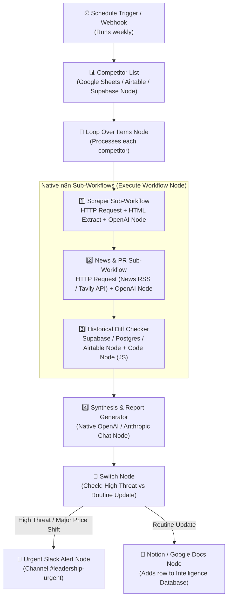

# Pure Native n8n Multi-Agent Intelligence System

> **100% Native n8n Canvas Architecture**  
> Built entirely using drag-and-drop n8n nodes (no Python scripts, no external LangChain code, and no terminal coding required). Everything runs directly inside your n8n workflow editor.

---

## 🎯 Native n8n Workflow Architecture



---

## 🧩 The Exact Native n8n Nodes Used

You don't need any external frameworks. You will only drag and drop these native n8n nodes:

| Node Name | Node Type | Purpose in this Project |
| :--- | :--- | :--- |
| **Schedule Trigger** | Core Trigger | Triggers the intelligence scan automatically every week at 8:00 AM. |
| **Airtable / Google Sheets** | Core App | Holds the list of competitor URLs (e.g. `/pricing`, `/changelog`). |
| **Loop Over Items** | Core Logic | Iterates through each competitor one by one without hitting API rate limits. |
| **Execute Workflow** | Core Logic | Calls modular sub-workflows, keeping your canvas clean and organized. |
| **HTTP Request** | Core Network | Fetches the raw HTML of competitor websites or calls search APIs. |
| **HTML Extract** | Core Transform | Extracts text from `<main>`, `article`, or pricing tables without needing Python. |
| **OpenAI / Gemini Model** | Native AI Node | Extracts clean JSON data (pricing plans, new features) from the text. |
| **Code Node (JavaScript)** | Core Logic | Runs a 5-line array diff to compare old prices vs new prices deterministically. |
| **Switch** | Core Routing | Branches based on whether there were significant changes or minor tweaks. |
| **Slack / Notion** | Core App | Sends executive cards to Slack and creates updated pages in Notion. |

---

## 🛠️ Step-by-Step Build Plan Inside n8n

### Step 1: Main Controller Workflow
1. Start with a **Schedule Trigger** (e.g., Every Monday at 9 AM).
2. Connect to an **Airtable Node** (or Google Sheets) with operation `Get Many Rows` from your `Competitors` table.
3. Connect to a **Loop Over Items Node** (Batch size = 1) so it processes one competitor at a time.

### Step 2: Sub-Workflow 1 – Web Scraper (Modular)
1. Add an **Execute Workflow Node** named `Scrape Competitor Site`.
2. Inside that sub-workflow:
   * **Workflow Inputs Trigger:** Receives the competitor URL.
   * **HTTP Request Node:** `GET` request to the competitor's `/pricing` page.
   * **HTML Extract Node:** CSS selector `body` or `main` -> output text.
   * **Basic LLM Chain Node** (or OpenAI Node):
     * **Prompt:**
       ```text
       Extract all pricing plans, prices, and features from this raw text into a clean JSON list:
       {{ $json.text }}
       ```
   * **Workflow Outputs Node:** Passes structured pricing data back to the main workflow.

### Step 3: Sub-Workflow 2 – Historic Comparison
1. Add an **Airtable / Supabase Node** to fetch the *previous week's* recorded pricing for this competitor.
2. Connect to a native **Code Node (JavaScript)**:
   ```javascript
   // Compares previous vs current pricing
   const current = $('Scrape Competitor Site').item.json.plans;
   const previous = $input.item.json.previous_plans || [];
   
   let changes = [];
   current.forEach(c => {
     const match = previous.find(p => p.name === c.name);
     if (!match) {
       changes.push({ plan: c.name, change: 'New Plan Added', currentPrice: c.price });
     } else if (match.price !== c.price) {
       changes.push({ plan: c.name, change: 'Price Changed', oldPrice: match.price, newPrice: c.price });
     }
   });
   
   return { hasChanges: changes.length > 0, changes: changes };
   ```

### Step 4: Step 4 – Executive Brief & Alerts
1. **OpenAI Node (Synthesizer):**
   * Uses GPT-4o-mini (very fast & cheap).
   * Generates a 3-bullet executive briefing highlighting what the competitor changed and the strategic takeaway.
2. **Switch Node:**
   * Rule: `{{ $json.hasChanges }} equals true`
   * **True path:** Sends a rich formatted card via **Slack Node** and updates **Notion**.
   * **False path:** Logs a simple timestamp note into Airtable ("No changes detected").

---

## 📁 Suggested n8n Workflow Exports

To showcase this in your portfolio, save and export these 3 clean JSON workflows from your n8n canvas:

1. `01-competitor-orchestrator.json` (The main loop & routing canvas)
2. `02-site-scraper-subworkflow.json` (HTTP + HTML Extract + LLM parsing)
3. `03-slack-notion-delivery.json` (Formatting & alerting)

---

## 💡 Why This Shines in an n8n Portfolio
* **100% Native:** Shows you master native n8n architecture (Loop Over Items, Sub-Workflows, Code node data transformations).
* **Cost-Efficient:** Uses HTML Extract + lightweight LLM prompts instead of blowing token budgets on raw HTML.
* **Deterministic:** Uses native JavaScript code for the math/price diffs so it never hallucinates price changes.
